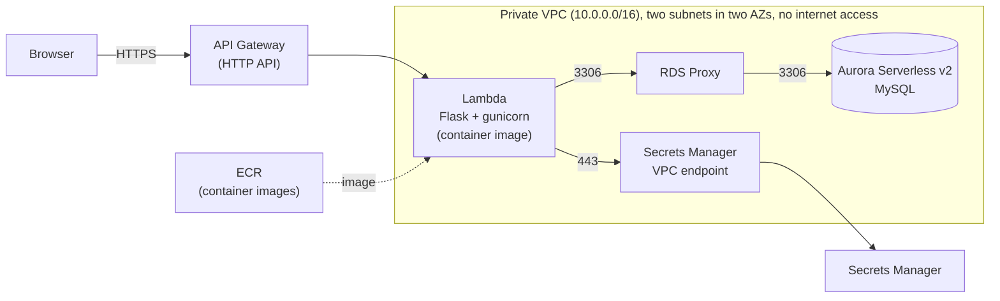
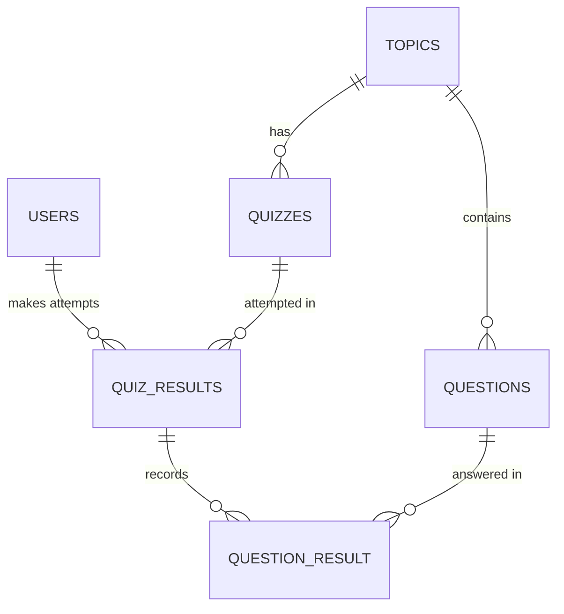
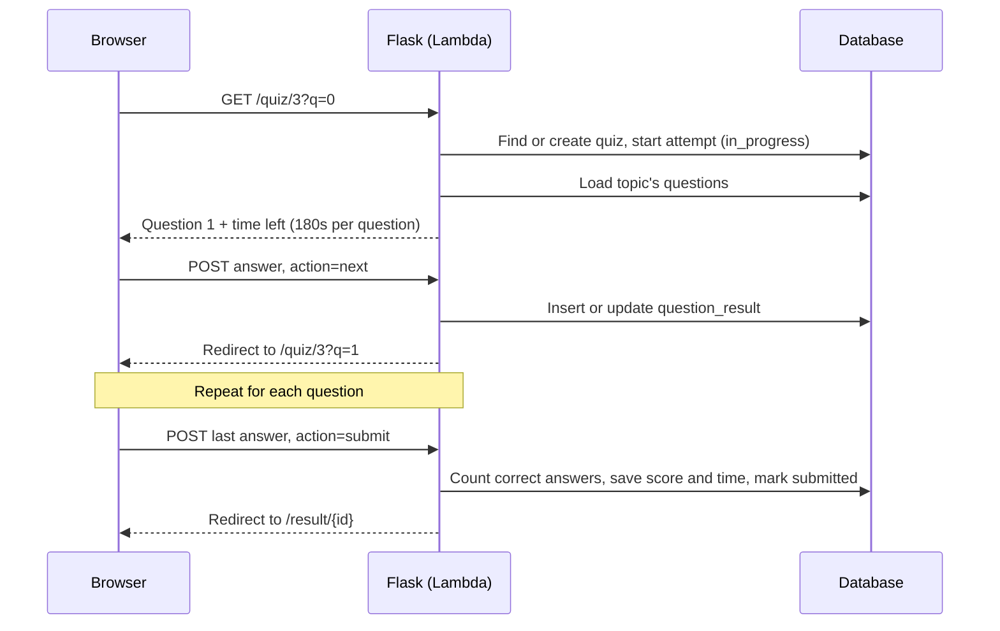
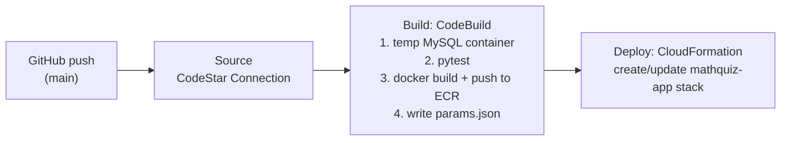

# MathQuiz: Architecture and Design Notes

*Documents the system as built and deployed, October 2026.*

## 1. Overview

MathQuiz is a web app for high school students (grades 9–12) to practice math by topic. Students sign up, pick a topic for their grade, answer timed multiple-choice and true/false questions, and review their scores, answers, and explanations afterward.

The app is a Flask application backed by MySQL. In production it runs serverless on AWS: a container-image Lambda behind API Gateway, with Aurora Serverless v2 behind RDS Proxy, all inside a private VPC. Both the application infrastructure and the CI/CD pipeline are defined in CloudFormation.

## 2. Architecture

| Component | Role |
|---|---|
| **API Gateway (HTTP API)** | Public HTTPS endpoint. Two catch-all routes (`ANY /` and `ANY /{proxy+}`) forward every request to the Lambda; Flask does all routing. |
| **Lambda** | Runs the unmodified Flask app as a container image. The AWS Lambda Web Adapter converts Lambda events into normal HTTP requests for gunicorn. 512 MB memory, 30-second timeout. |
| **RDS Proxy** | Pools database connections so many short-lived Lambda instances don't exhaust Aurora's connection limit. Authenticates clients against Secrets Manager. |
| **Aurora Serverless v2 (MySQL 8.0-compatible)** | Stores all data. Scales between 0.5 and 2 ACU. One serverless writer instance. |
| **Secrets Manager** | Holds the database credentials (password generated by Secrets Manager) and Flask's session-signing key. |
| **Secrets Manager VPC endpoint** | Lets the Lambda reach Secrets Manager privately, since the VPC has no internet or NAT gateway. |
| **ECR** | Stores the container images built by the pipeline, with vulnerability scanning on push. |

## 3. Data Model

| Table | Purpose |
|---|---|
| `users` | Accounts. Passwords are stored as salted hashes (Werkzeug), never plain text. |
| `topics` | Subject areas, each tied to a grade level. |
| `questions` | The question bank. Each question belongs to one topic, with four options, the correct option, and an explanation. |
| `quizzes` | A playable quiz for a topic. A NULL `topic_id` represents a grade-wide cumulative quiz. |
| `quiz_results` | One row per attempt: who, which quiz, status (`in_progress` / `submitted`), score, and total time. |
| `question_result` | One row per answered question within an attempt: the option picked and whether it was correct. |

Users don't link to quizzes directly. Each time a user takes a quiz, a `quiz_results` row records that attempt with both `user_id` and `quiz_id`, so one user can take many quizzes, one quiz can be taken by many users, and the same user can retake a quiz as many times as they like.

Questions are stored separately from quizzes so each question exists once, can be reused, and has its own ID that answers can reference.

## 4. Request Flow: One Quiz Attempt

- **Login state** is a user ID stored in Flask's signed session cookie. The signature (made with the secret key from Secrets Manager) prevents tampering.
- **The current attempt** is tracked in the session and checked against the database on each request, so an attempt is only reused if it belongs to this user, this quiz, and is still in progress.
- **The per-question timer** records when each question was first shown, server-side, so refreshing the page doesn't reset it.
- **Score** is the number of correct answers. A topic counts as completed once the student scores 8 or more.

## 5. Startup and Database Initialization

- **On cold start** (when `app.py` is imported), the app fetches the Flask secret key and database credentials from Secrets Manager. The secret ARNs come from environment variables set by CloudFormation; the credentials themselves exist only in the process's memory.
- **On the first request** to each Lambda instance, a `before_request` hook calls `init_db()`. It creates the schema if the tables don't exist and loads the seed data if there are no topics. It's idempotent: once the data exists it does nothing. If setup fails, the instance retries on its next request.
- **Locally**, none of this runs. The app connects with default settings (`localhost`, `mathquiz_app`) or environment variables.

## 6. CI/CD Pipeline

- **Source** pulls `main` through a CodeStar Connection and triggers on every push.
- **Build** (`buildspec.yml`) starts a disposable MySQL 8.0 container, loads the schema, and runs the test suite against it. A failing test stops the pipeline. If tests pass, it builds the image from `Dockerfile.lambda`, tags it with the Git commit ID, pushes it to ECR, and writes the image address to `params.json`.
- **Deploy** has CloudFormation create or update the app stack from `infra/template.yaml`, using `params.json` for the image. A code-only change updates just the Lambda.

### Two stacks

| Stack | Template | Contains | Deployed by |
|---|---|---|---|
| `mathquiz-pipeline` | `infra/pipeline.yaml` | CodePipeline, CodeBuild, ECR, artifact bucket, pipeline IAM roles | Manually, once |
| `mathquiz-app` | `infra/template.yaml` | VPC, endpoint, security groups, secrets, Aurora, RDS Proxy, Lambda, API Gateway | The pipeline, on every run |

Keeping them separate allows the app stack, where the hourly database costs are, to be deleted between demos and recreated from the pipeline in about 15–20 minutes.

## 7. Key Design Decisions

**Serverless Lambda instead of an always-on server.**
No servers to manage, and compute is billed per request. Trade-off: cold starts make the first request after idle slower, and the database still has a minimum hourly cost.

**Lambda Web Adapter instead of rewriting the app for Lambda.**
The same Flask code runs locally with `flask run` and on Lambda under gunicorn, with no Lambda-specific handler. Trade-off: an extra component in the container image.

**Container image instead of a zip package.**
Larger size limit (10 GB vs. 250 MB unzipped) and a reproducible build that can be run anywhere Docker runs.

**RDS Proxy in front of Aurora.**
Each Lambda instance opens its own connection, and instances come and go constantly. The proxy reuses a pool of connections to the database. Trade-off: additional hourly cost.

**A Secrets Manager VPC endpoint instead of a NAT gateway.**
The Lambda only needs to reach one AWS service outside the VPC. An interface endpoint costs less than a NAT gateway and opens access only to Secrets Manager, not the whole internet.

**App-managed database setup instead of a CloudFormation custom resource.**
The first design loaded the schema with a custom-resource Lambda during deployment. That Lambda ran in the private VPC and couldn't reach S3 to report completion back to CloudFormation, so deploys and deletes hung until they timed out. Moving setup into the app removed the problem: the app Lambda already has database access and never needs to signal CloudFormation. Trade-off: the first request after a fresh deploy is slow while the seed data loads.

**Two CloudFormation stacks.**
Separates long-lived, cheap CI/CD infrastructure from the costly application stack, so the app can be torn down without losing the pipeline.

## 8. Security

- **Network isolation.** Everything runs in private subnets with no internet gateway or NAT. Security groups form a chain: only the Lambda can reach the proxy, only the proxy can reach Aurora, and only the Lambda can reach the Secrets Manager endpoint.
- **Secrets.** The database password is generated by Secrets Manager and passed to Aurora through a CloudFormation dynamic reference, so it never appears in code or configuration. The Lambda fetches credentials at runtime.
- **Least-privilege runtime roles.** The Lambda's role can read only its two secrets; the proxy's role can read only the database secret. The pipeline can pass only one specific role to CloudFormation.
- **Application.** Parameterized SQL queries throughout (no string-built SQL), hashed passwords, signed session cookies, a generic login error message, and ownership checks so users can only view their own results.
- **Transport.** API Gateway serves HTTPS by default.

## 9. Testing

- 32 pytest tests covering login guards, signup and login, the quiz flow, scoring, access control, and past attempts, including regression tests for previously fixed bugs (time calculation, topic switching, result ownership).
- A fixture resets the test database to a known state before every test.
- Tests always run against a separate `mathquiz_test` database: a disposable MySQL container in CI, and a local test database (set in `conftest.py`) during development, so local data is never touched.

## 10. Known Limitations and Next Steps

| Area | Limitation | Next step |
|---|---|---|
| IAM | The CloudFormation deploy role uses broad managed policies (PowerUserAccess + IAMFullAccess). | Restrict to the services the template uses and add a permissions boundary. |
| Secrets | The Flask secret key is supplied as a pipeline parameter and is visible in the pipeline's configuration. | Generate it inside the app template with Secrets Manager. |
| Transport | Connections from the Lambda to RDS Proxy don't require TLS (traffic stays inside the VPC). | Enable `RequireTLS` and TLS in the database client. |
| Database user | The app connects as the Aurora master user. | Create a dedicated application user with limited privileges. |
| Timing | Time spent per question isn't recorded; only total attempt time is accurate. | Store elapsed time when each answer is saved. |
| Cold start | First-run seeding can approach the 30-second API Gateway limit. | Move seeding out of the request path. |
| Testing | Tests run on the build machine rather than inside the shipped container image. | Run the test suite inside the built image. |
| Housekeeping | No lifecycle rules for ECR images, pipeline artifacts, or logs; Aurora leaves a final snapshot on stack deletion. | Add lifecycle and retention policies; set the deletion policy explicitly. |
| Availability | Single Aurora instance with no replica. | Add a reader instance if uptime matters. |
| Features | The `quizzes.time_limit` column and paused-attempt status exist in the schema but aren't used. | Implement or remove. |